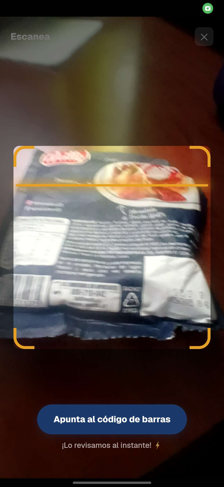
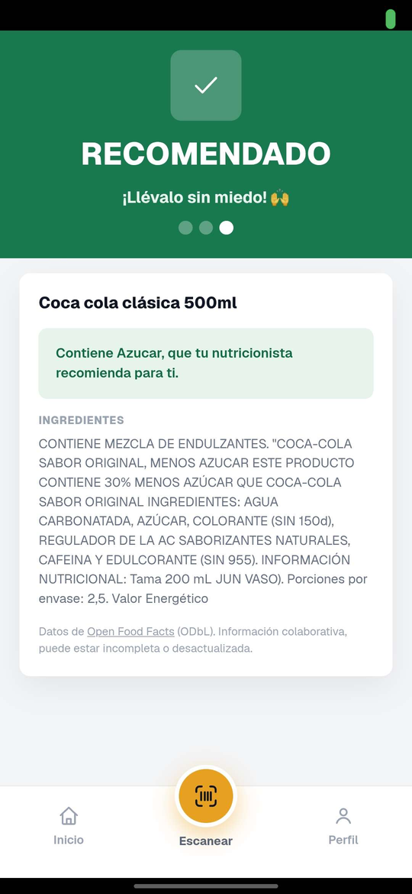
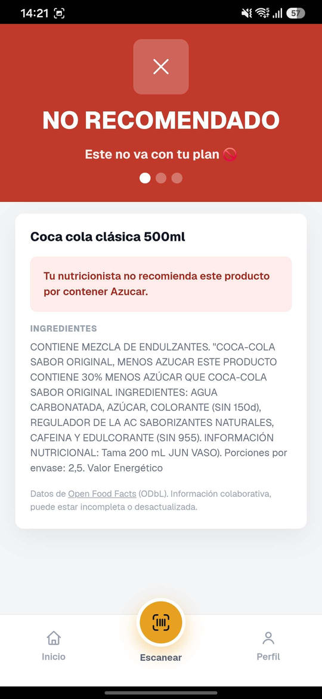
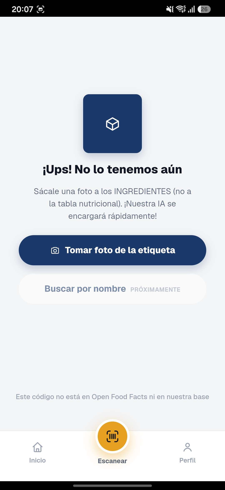
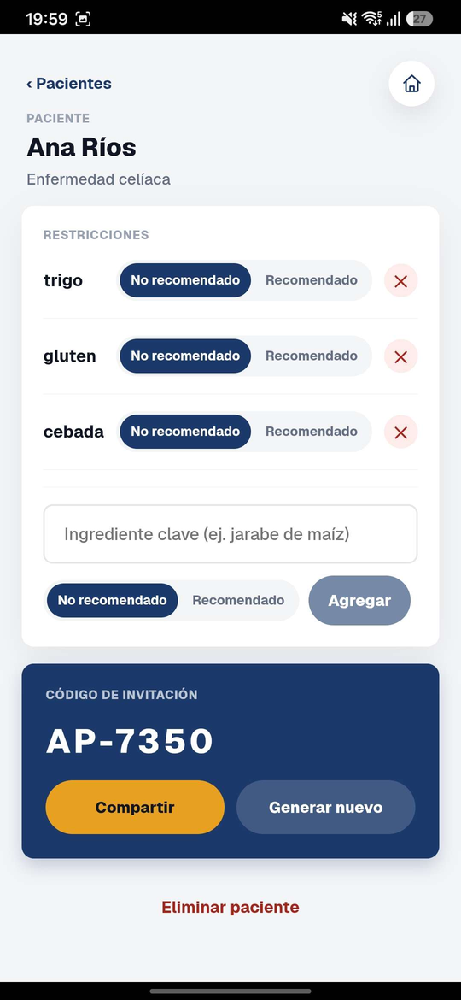
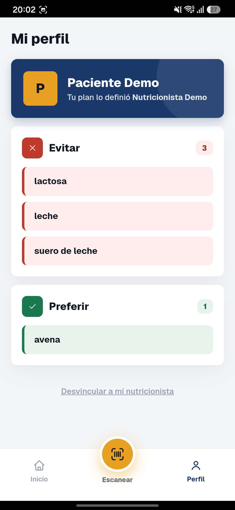

# Apto

**Escáner de etiquetas que responde una sola pregunta: ¿este producto es apto para mí?**

Un paciente apunta la cámara al código de barras de un producto en el supermercado y
recibe un veredicto en tres estados — **no recomendado**, **neutro** o **recomendado** —
calculado contra las reglas alimentarias que su nutricionista definió para él. Si los
datos del producto no alcanzan para responder con confianza, la app lo dice en vez de
adivinar, y ofrece sacarle una foto a la etiqueta para leer los ingredientes con OCR.

PWA instalable. Next.js 16 + TypeScript + Supabase, desplegada en Cloudflare Workers.

> Versión de portafolio de un MVP desarrollado como proyecto real. Los datos son
> ficticios y la identidad visual es distinta de la del proyecto original.

---

## Probar la demo

**[apto-app.workers.dev](https://apto-app.workers.dev)** ← reemplazar con tu URL

En 30 segundos, sin crear cuenta:

1. Abrir **Conecta con tu nutricionista** e ingresar el código **`AP-4821`**.
2. Volver al inicio y tocar **Escanear**.
3. Escanear cualquier producto envasado que tenga leche o lactosa en los
   ingredientes → sale en rojo, con el motivo.
4. Escanear algo sin lácteos → sale en neutro o verde.

Códigos de los pacientes demo: `AP-4821` (intolerancia a la lactosa) y `AP-7350`
(celiaquía). Hay un tercer paciente sin código a propósito, para ver el estado
"paciente sin código generado" en el panel.

Panel de nutricionista: `/nutricionista/ingresar`, cuenta demo `demo@apto.local`.
Desde ahí se crean pacientes, se les definen reglas y se generan los códigos de
vinculación.

> Es una demo sobre free tier. El primer request después de un rato puede tardar
> unos segundos en despertar.

## Capturas

**El mismo producto, dos pacientes distintos.** Las dos capturas del medio son el
mismo código de barras escaneado por dos personas: el veredicto no es una propiedad
del producto, sino del cruce entre sus ingredientes y las reglas que el
nutricionista definió para cada paciente.

| Escaneo | Recomendado, para quien puede | El mismo producto, para quien no |
|---|---|---|
|  |  |  |

| Producto desconocido → foto | Panel del nutricionista | Perfil del paciente |
|---|---|---|
|  |  |  |

---

## El problema

Un nutricionista le dice a un paciente celíaco "no comas nada con cebada". En el
supermercado, el paciente tiene que leer la letra chica de cada envase y acordarse de
la lista completa. Es tedioso, y se equivoca.

La app traslada ese trabajo al teléfono: el nutricionista escribe las reglas una vez,
el paciente escanea y ve la respuesta.

## Cómo funciona

```
 Paciente                   Servidor (Cloudflare Worker)             Datos
 ────────                   ────────────────────────────             ─────
 escanea el código  ──────▶  GET /api/producto/[codigo]
 de barras                         │
                                   ├─ 1. ¿está en productos_propios?  ──▶ Supabase
                                   ├─ 2. ¿está en off_cache?          ──▶ Supabase
                                   └─ 3. Open Food Facts API v3       ──▶ OFF
                                         └─ guarda en off_cache       ──▶ Supabase
                                   │
 ve el veredicto    ◀──────  producto + reglas del paciente
                             │
                             └─ si el dato no alcanza:
                                foto de la etiqueta ──▶ POST .../foto
                                                         └─ Gemini (OCR) ──▶ productos_propios
```

El veredicto se calcula comparando las reglas del paciente (substrings como
`lactosa`, `gluten`) contra el texto de ingredientes del producto. Una regla
`vetado` que coincide gana siempre sobre una `recomendado`.

## Stack

| Capa | Elección | Por qué |
|---|---|---|
| Framework | Next.js 16 (App Router) + TypeScript estricto | Server Components para el panel del nutricionista, Route Handlers para todo lo que toca secretos o APIs externas. |
| Hosting | Cloudflare Workers vía `@opennextjs/cloudflare` | Free tier con edge global y Cron Triggers incluidos. La restricción real de esta decisión (bundle < 3 MiB) está más abajo. |
| Base de datos | Supabase (Postgres + Auth + RLS) | Auth y autorización a nivel de fila sin escribir un backend propio. Free tier. |
| Escáner | `BarcodeDetector` nativo, con `@undecaf/zbar-wasm` como fallback | Ninguno de los dos alcanza solo — ver la decisión 5. |
| OCR | Gemini con `responseSchema`, solo server-side | Devuelve JSON tipado en vez de texto libre que haya que parsear. |
| Datos de productos | Open Food Facts API v3 (ODbL) | Base colaborativa, sin costo, con cobertura razonable en Chile. |
| Estilos | CSS Modules + tokens en `:root` | Sin dependencia de un framework de CSS; el tema entero sale de un bloque de variables. |

---

## Decisiones de diseño

Esta es la parte interesante del proyecto. Cada una responde a una restricción
concreta, no a una preferencia.

### 1. El semáforo falla hacia el lado seguro

Un falso "recomendado" a un paciente celíaco es un daño real. Un falso "no sé" es
una molestia. El sistema está sesgado a propósito hacia el segundo error.

Concretamente, el veredicto **nunca puede ser verde** si el dato viene de Open Food
Facts y se cumple cualquiera de estas tres condiciones:

- `states_tags` no incluye `en:ingredients-completed` → la lista de ingredientes
  está incompleta según OFF mismo.
- `last_modified_t` tiene más de 2 años → la formulación pudo cambiar.
- `data_quality_errors_tags` incluye un error **sobre los ingredientes** → OFF
  detectó una inconsistencia en la lista misma.

Ese tercer corte empezó siendo más ancho —cualquier error de calidad
descalificaba— y se acotó al medirlo: de los 33 tipos de error que OFF reporta
en el catálogo cacheado, **32 son sobre la tabla nutricional** (calorías que no
cuadran, sal que no coincide con el envase) y uno solo es sobre ingredientes. Y
el veredicto se calcula únicamente con el texto de ingredientes: la tabla
nutricional no se lee nunca, así que un producto con las calorías mal sumadas no
es menos confiable para saber si contiene lactosa. Acotarlo llevó los productos
que devuelven un veredicto real del 88% al 99%, sin cambiar la dirección del
error: un problema en los ingredientes sigue mandando a "datos incompletos".

En esos casos el estado es **"datos incompletos"**, y la UI ofrece el flujo de foto.
Mismo criterio para los productos cargados por OCR: un dato sin verificar **puede
vetar** (ante la duda, avisar) pero **nunca recomienda en verde**.

Eso cubre la mitad del problema: el dato del producto. La otra mitad son las reglas
del paciente, y ahí el modo de fallar es menos obvio. Si la consulta de reglas falla
—red caída, endpoint con error— es tentador tratar la respuesta como "sin reglas" y
seguir. Pero un producto evaluado contra cero reglas sale **neutro**, con el texto
"con moderación, sin problema": un paciente intolerante a la lactosa escaneando un
lácteo recibiría vía libre porque se cayó un servicio. Por eso "este paciente no
tiene reglas" y "no pudimos averiguar qué reglas tiene" son estados **distintos** en
el código, imposibles de confundir por construcción:

- El endpoint (`app/api/pacientes/[id]/reglas/route.ts`) responde 400 a un id mal
  formado, 404 si el paciente no existe, 500 si la consulta falló, y 200 solo cuando
  sabe la respuesta. Una lista vacía en un 200 sí significa "sin reglas".
- El cliente modela las reglas como `cargando | listas | error`, no como una lista
  que puede estar vacía por dos motivos opuestos.
- Con las reglas en `error` **no se emite ningún veredicto**, ni siquiera neutro: se
  muestra la ficha del producto y un aviso de que no se pudo revisar, con reintento.

La misma distinción aplica en `/perfil` (que si no diría "tu plan está en camino")
y en el panel del nutricionista (que mostraría un plan vacío y lo invitaría a
cargar reglas duplicadas).

**Y falta un tercer modo de fallar, que es el que no se ve leyendo la función.**
Todo lo anterior protege contra el dato que *falta*. Nada protegía contra el dato
*falso*: la ruta que crea productos por foto es pública —tiene que serlo, es el
flujo para cuando OFF no conoce un producto— y escribe en `productos_propios`.
Como esa tabla se consultaba antes que `off_cache`, una fila escrita ahí tapaba
al producto real. Medido con `calcularVeredicto` sobre una leche con lactosa
vetada: el dato de OFF daba **vetado**, y una fila de OCR con los ingredientes
cambiados daba **neutro, "con moderación, sin problema"**.

La solución no fue cerrar el endpoint sino quitarle la consecuencia. El orden de
resolución pasó a ser `manual` → `off_cache` → `ocr` → OFF: el dato sin verificar
llena huecos pero no pisa dato verificado. Es el mismo criterio que la regla ya
aplicaba —un dato por foto puede vetar pero no recomendar— extendido a que
tampoco pueda sustituir.

→ [`lib/veredicto.ts`](lib/veredicto.ts), función `calcularVeredicto`, con sus tests
en [`lib/veredicto.test.ts`](lib/veredicto.test.ts). Vive separada de la pantalla que
la usa justamente para poder testearla sin montar React ni red.

### 2. Dos tablas de productos que no se pueden fusionar

Los datos de Open Food Facts están bajo **ODbL**, que tiene cláusula de
*share-alike*: si se mezclan con datos propios se crea una base derivada, y aparece
la obligación de publicar la base completa bajo la misma licencia.

Por eso hay dos tablas que nunca se cruzan:

- **`off_cache`** — cache de Open Food Facts, licencia ODbL.
- **`productos_propios`** — dato propio (OCR y carga manual).

Está prohibido copiar campos de una a la otra, o "rellenar huecos" de una con la
otra. La única relación entre ambas es el código de barras, resuelta en tiempo de
consulta: la ruta busca primero en `productos_propios`, después en `off_cache`, y
solo entonces le pega a OFF. Nunca combina un registro de las dos.

Las dos llevan columnas `fuente` (`off` | `ocr` | `manual`) y `fecha_dato`, así que
la procedencia de cada fila es siempre explícita.

### 3. Toda llamada a Open Food Facts pasa por el servidor

No por preferencia arquitectónica: OFF pide un `User-Agent` identificatorio, y
`User-Agent` es un [header prohibido](https://developer.mozilla.org/en-US/docs/Glossary/Forbidden_header_name)
que el navegador no deja setear desde `fetch`. El fetch directo desde el cliente
queda descartado por el protocolo, no por gusto.

El Route Handler además persiste la respuesta en `off_cache`, así que el segundo
escaneo del mismo producto no vuelve a pegarle a una API comunitaria gratuita. En
desarrollo apunta al staging de OFF (`world.openfoodfacts.net`), nunca a producción.

→ [`app/api/producto/[codigo_barras]/route.ts`](app/api/producto/[codigo_barras]/route.ts)

### 4. RLS filtra filas, no controla la forma de la consulta

Un visitante anónimo necesita validar su código de invitación (`AP-4821`) contra la
tabla `pacientes`. La solución obvia —una policy de RLS de lectura pública sobre
`pacientes`— está mal, y el motivo es sutil:

RLS decide *qué filas* ve un cliente, no *qué consulta* puede escribir. Cualquier
policy de lectura anónima sobre `pacientes` habilitaría un `select *` sin filtrar, y
devolvería **todos** los pacientes con nombre y diagnóstico, no solo el que coincide
con el código.

La validación pasa entonces por un Route Handler con `service_role` que solo permite
un lookup exacto por `codigo_invitacion` y devuelve el mínimo de datos. El límite lo
impone la forma del endpoint, no la policy.

Ese endpoint tiene además un rate limiter de Cloudflare, configurado en 10 req/min por
IP: el código es de 4 caracteres de un alfabeto de 31, o sea 31⁴ = 923.521
combinaciones — quince minutos de trabajo para un script sin nada que lo frene.

**Cuánto frena realmente, medido y no asumido.** La API de rate limiting de Workers
cuenta por centro de datos y es eventualmente consistente, así que el límite no se
comporta igual en desarrollo que en producción:

| Entorno | 60 requests seguidos |
|---|---|
| `next dev` y `npm run preview` | corte exacto: pasan 10, el resto 429 |
| Producción (workers.dev) | **8 bloqueados de 60** (13%), en ráfagas irregulares |

O sea que en producción no es una compuerta que se cierra, sino una fricción: sube el
costo del ataque de ~15 minutos a varios días desde una sola IP, pero no lo vuelve
imposible. Para un proyecto de demostración con pacientes ficticios alcanza. Para datos
reales no: ahí el código de invitación tendría que ser más largo, de un solo uso, o con
vencimiento — las tres cosas son baratas y ninguna está implementada acá.

→ [`supabase/migrations/20260725000001_codigo_invitacion.sql`](supabase/migrations/20260725000001_codigo_invitacion.sql),
[`app/api/vinculacion/route.ts`](app/api/vinculacion/route.ts)

### 5. Dos detectores de código de barras, no uno

Ninguna opción sola funcionaba bien en la calle:

- **`BarcodeDetector`** (Shape Detection API) usa el detector nativo de Android. Es
  sensiblemente más rápido y tolera mucho mejor el desenfoque y la poca luz de un
  pasillo de supermercado. Pero solo lo implementa Chromium en Android.
- **`@undecaf/zbar-wasm`** funciona en todas partes, incluido iOS, a costa de
  velocidad.

La app intenta el nativo y cae al WASM si no está disponible o falla al inicializar.
El `.wasm` se sirve como asset propio desde `public/`, nunca desde un CDN de
terceros.

→ [`app/escanear/EscaneoCliente.tsx`](app/escanear/EscaneoCliente.tsx)

### 6. Cloudflare Workers en free tier: 3 MiB de presupuesto

El límite de bundle comprimido del free tier es 3 MiB, y eso condiciona el código.
El OCR, por ejemplo, le pega a la REST API de Gemini con `fetch` directo en lugar de
usar el SDK oficial: el resultado es el mismo y el bundle no crece.

Medido con `npx wrangler deploy --dry-run` (Next 16.2.10, `@opennextjs/cloudflare`
1.20.1, wrangler 4.112.0): **6710 KiB sin comprimir, 1362 KiB gzip**. O sea que el
presupuesto está usado al 44%, con margen para crecer al doble antes de tocar el
techo. Conviene volver a medirlo al agregar cualquier dependencia de servidor — es un
comando, y es la diferencia entre enterarse ahora o en el deploy.

Otras dos consecuencias del runtime:

- **`images: { unoptimized: true }`** en `next.config.ts`. El loader por defecto de
  `next/image` apunta al optimizador de Vercel y el build falla fuera de ahí.
- **`npm run build` usa `--webpack`.** Con Turbopack (el default en Next 16) el
  build de `@opennextjs/cloudflare` genera un worker roto: `ChunkLoadError` y 500 en
  runtime. Está anotado en `package.json` para revertirlo cuando el adapter lo
  soporte.

Corolario: `next dev` corre en Node y esconde errores propios de `workerd`. Ninguna
feature se da por terminada sin pasar por `npm run preview`, que construye y sirve
sobre el runtime real.

### 7. El cron existe porque el free tier se apaga

Supabase pausa un proyecto free tier a los 7 días sin actividad, y un ping HTTP al
dominio **no cuenta** como actividad — tiene que ser una consulta real a la base.

Un Cron Trigger de Cloudflare corre cada 3 días y hace un `select` mínimo sobre
`off_cache`. El handler `scheduled` no lo genera `@opennextjs/cloudflare`, así que
`custom-worker.ts` envuelve el worker generado, reexporta su `fetch` y agrega el
`scheduled` propio.

Usa la anon key, no `service_role`: `off_cache` tiene lectura pública, y mantener el
proyecto despierto no justifica saltear RLS.

→ [`custom-worker.ts`](custom-worker.ts)

### 8. El seed es el backup

El free tier de Supabase no tiene backups automáticos. `supabase/seed.sql` está
versionado y es idempotente (IDs fijos más `ON CONFLICT`), así que el estado completo
se reconstruye corriendo las migraciones y el seed. No es un archivo de ejemplo: es
la única copia.

### 9. Un solo bloque de tokens para todo el color

Ningún CSS Module declara un color opaco: los ocho toman sus valores de las
variables definidas en [`app/globals.css`](app/globals.css), así que cambiar el tema
entero —paleta, radios, sombras— es editar un bloque de unas 50 líneas. Lo único que
queda inline son `rgba()` translúcidos de sombras y overlays, que son negros y
blancos con alfa y no cambian con el tema.

Los tokens del semáforo vienen en tríos: el color sólido, el fondo suave del badge y
el color de texto sobre ese fondo. El de texto es más oscuro que el sólido a
propósito, porque el sólido no llega a 4.5:1 de contraste sobre su propio tinte.

---

## Estructura

```
app/
├─ page.tsx                      Inicio: saludo, acceso al escáner, estado de vinculación
├─ escanear/                     Cámara + detección de código de barras (client-only)
├─ producto/[codigo_barras]/     Ficha del producto y veredicto del semáforo
│  └─ foto/                      Flujo de OCR cuando el dato no alcanza
├─ vinculacion/                  Ingreso del código AP-XXXX
├─ perfil/                       Reglas del paciente, en solo lectura
├─ nutricionista/                Auth y panel: pacientes, reglas, códigos
├─ admin/productos/              Tablero interno de avance de la precarga manual
├─ api/
│  ├─ producto/[codigo_barras]/  Resolución del producto (propios → cache → OFF)
│  │  └─ foto/                   OCR con Gemini → productos_propios
│  ├─ vinculacion/               Validación del código (service_role + rate limit)
│  ├─ pacientes/[id]/reglas/     CRUD de reglas
│  └─ nutricionista/pacientes/   CRUD de pacientes
├─ globals.css                   Todos los tokens de diseño
└─ manifest.ts                   Manifest de la PWA

lib/
├─ veredicto.ts                  El semáforo: lógica pura, testeable sin React
├─ veredicto.test.ts             19 casos, uno por regla del semáforo
└─ supabase/                     Clientes: browser, server (anon) y server (service_role)
supabase/
├─ migrations/                   Esquema, versionado y en orden
└─ seed.sql                      Datos demo — y el backup del free tier
custom-worker.ts                 Worker de OpenNext + handler scheduled del keep-alive
```

## Puesta en marcha

Requiere Node 20+, una cuenta de Supabase y una de Cloudflare (las dos en free tier
alcanzan), y una API key de Gemini si se quiere probar el OCR.

```bash
git clone https://github.com/TU-USUARIO/apto-app.git
cd apto-app
npm install

cp .env.example .env.local        # lo lee next dev y el build
cp .dev.vars.example .dev.vars    # lo lee wrangler
# completar los dos con los valores del proyecto de Supabase

npm run cf-typegen                # genera cloudflare-env.d.ts (no se versiona)
npm run dev
```

Base de datos: correr los archivos de `supabase/migrations/` en orden en el SQL
editor de Supabase, registrar la cuenta demo desde `/nutricionista/registro` con el
correo que figura en `seed.sql`, y después correr `seed.sql`.

Para desplegar, además:

```bash
npx wrangler kv namespace create apto-inc-cache      # pegar el id en wrangler.jsonc

# Las seis credenciales van como secretos, no en wrangler.jsonc:
npx wrangler secret put SUPABASE_URL
npx wrangler secret put SUPABASE_ANON_KEY
npx wrangler secret put NEXT_PUBLIC_SUPABASE_URL
npx wrangler secret put NEXT_PUBLIC_SUPABASE_ANON_KEY
npx wrangler secret put SUPABASE_SERVICE_ROLE_KEY
npx wrangler secret put GEMINI_API_KEY

npm run deploy
```

Las claves de Supabase son dos y **no son lo mismo**, aunque acá las dos terminen
como secretos:

- La **publishable/anon key** no es un secreto: está diseñada para viajar al navegador
  y la seguridad no la da ocultarla, la da Row Level Security. Verificado: con esa
  clave se pueden leer `off_cache` y `productos_propios` —datos públicos de Open Food
  Facts— y las tablas del circuito clínico devuelven **cero filas aunque tengan
  datos**, porque RLS las esconde. Escribir devuelve 401.
- La **service_role key** sí es secreta, porque **bypasea RLS**: con ella una consulta
  ve todas las filas de todas las tablas. La usan las rutas que necesitan hacer algo
  que RLS no puede expresar — validar un código de invitación sin exponer un listado
  de pacientes (ver la decisión 4), escribir en `off_cache`, guardar lo que devuelve
  el OCR, y crear o borrar un paciente, que son dos tablas en una operación.

Entonces, ¿por qué la anon key también va como secreto si no lo es? Por una razón
distinta de la seguridad: **este repo es público y `wrangler.jsonc` se versiona**.
Publicar ahí la URL del proyecto revelaría contra qué instancia de Supabase corre la
demo, y eso invita a consumirle la cuota del free tier. No es un riesgo de datos, es
uno de disponibilidad.

Un detalle que cuesta descubrir: Cloudflare **rechaza un secreto que se llame igual que
un `var`** ("Binding name already in use", código 10053). No hay precedencia entre
ambos —hay conflicto— así que una misma clave no puede estar en los dos lados por las
dudas: o está en `wrangler.jsonc`, o es un secreto.

Las seis se leen igual desde el código, con `getCloudflareContext().env`, y ninguna
entra al bundle del cliente.

## Comandos

```bash
npm run dev         # next dev — iteración rápida (runtime Node, no workerd)
npm run build       # next build --webpack
npm run preview     # build + preview sobre el runtime real de Workers
npm run deploy      # build + deploy a Cloudflare
npm run lint        # eslint
npm run cf-typegen  # regenera los tipos del entorno desde wrangler.jsonc
```

## Limitaciones conocidas

Es un MVP, y estas son las costuras que se ven:

- **Las reglas son coincidencia de substrings.** `sal` matchea también `salvado`. Un
  motor real necesita normalización y lista de sinónimos, o mejor, apoyarse en los
  `allergens_tags` de OFF en lugar del texto plano.
- **La vinculación paciente–app vive en `localStorage`.** No hay cuenta de paciente:
  el código de invitación guarda el vínculo en el dispositivo. Suficiente para la
  demo, insuficiente para varios dispositivos por paciente.
- **Un paciente, un nutricionista.** La tabla `asignaciones` tiene `paciente_id` como
  `unique`.
- **Los tests cubren el semáforo y nada más.** `lib/veredicto.ts` tiene 19 casos, uno
  por regla: los cuatro cortes de calidad de OFF, que vetado gane sobre recomendado,
  que un dato por OCR pueda vetar pero nunca recomendar, y que `sal` matchee `salvado`
  (fijada como está, para que normalizarla sea un cambio deliberado). Lo que no está
  cubierto es todo lo demás: componentes, rutas y red. La elección es a propósito —esa
  función es la única donde un bug tiene consecuencias sobre una persona.
- **El binding de KV está declarado pero el cache incremental no está habilitado** en
  `open-next.config.ts`. Funciona igual, pero es una inconsistencia a resolver.
- **El OCR devuelve texto sin verificar.** Por eso nunca habilita un verde, pero
  falta el paso de revisión por parte del nutricionista.

## Licencias y atribución

Este proyecto es **MIT** (ver [LICENSE](LICENSE)).

Los datos de productos provienen de **[Open Food Facts](https://world.openfoodfacts.org)**
y están bajo **[Open Database License (ODbL)](https://opendatacommons.org/licenses/odbl/1-0/)**.
La atribución es visible en toda pantalla que muestre esos datos, junto al disclaimer
de que son datos colaborativos que pueden estar incompletos o desactualizados. Los
datos de OFF viven aislados en `off_cache` y no se fusionan con datos propios (ver la
decisión 2).

Los nombres, diagnósticos y reglas de la base de demostración son ficticios.
